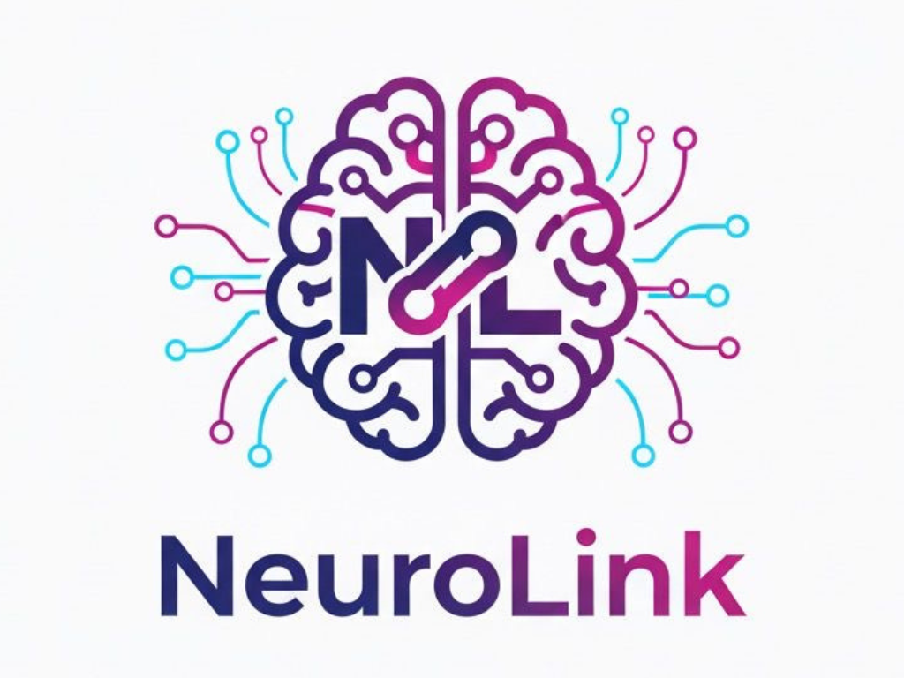
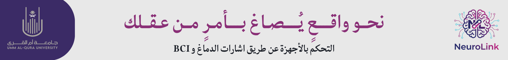
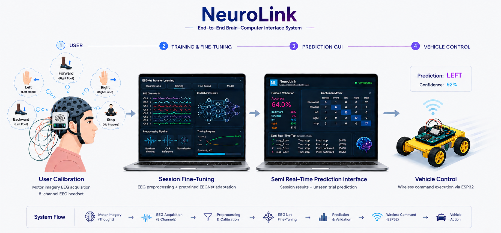
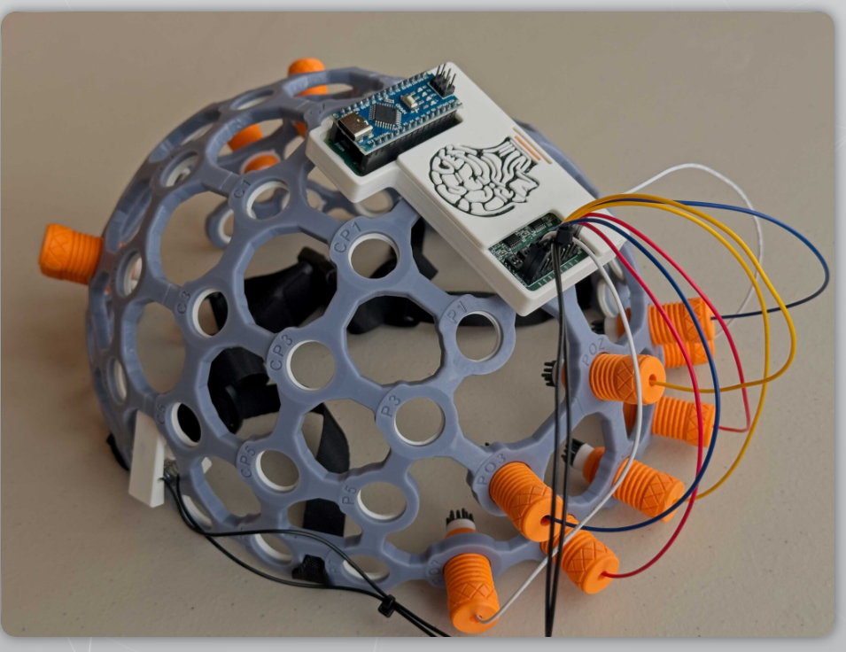
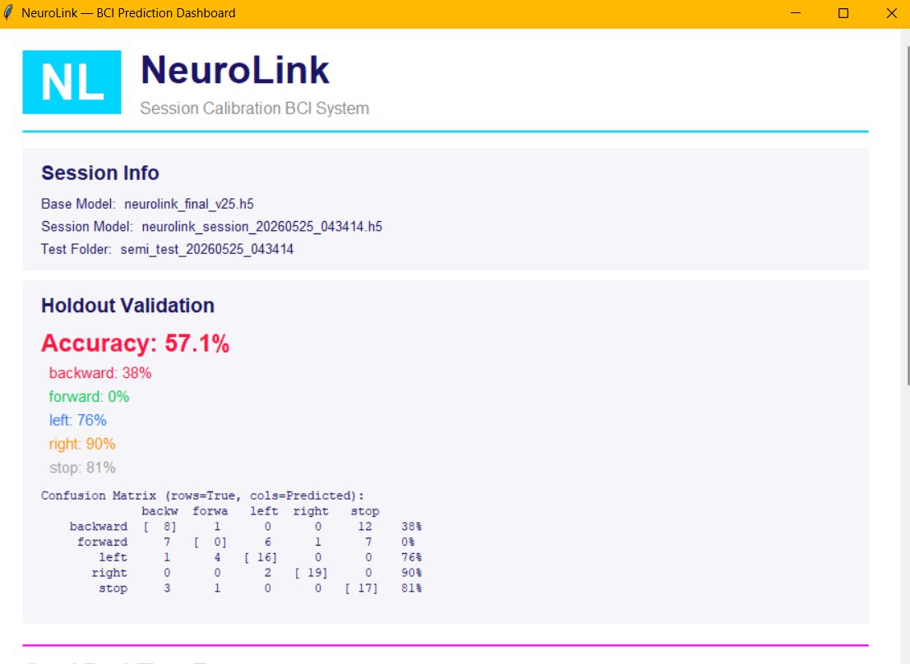
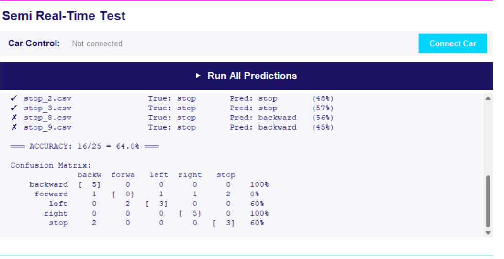
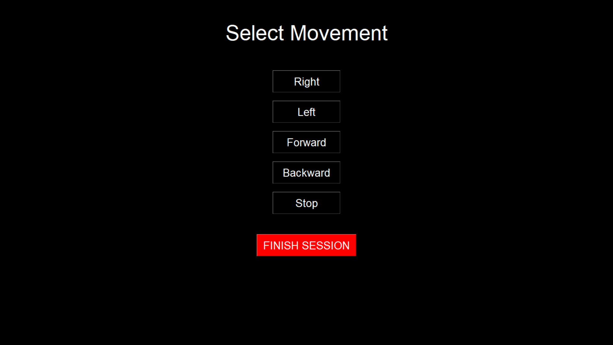

<p align="center">
  
</p>

<h1 align="center">NeuroLink</h1>

<p align="center">
  
</p>

<p align="center"><b>EEG-Based Brain-Computer Interface for Controlling Devices via Neural Commands</b></p>

<p align="center">
  
  
  
  
  
</p>

---

## Overview

**NeuroLink** is a Brain-Computer Interface (BCI) system that translates motor imagery EEG signals into real-time commands to control a 2WD robotic car — no physical movement required.

The user imagines a body movement (e.g., right hand, left foot), the EEG headset captures the brain signal, and the system classifies it and wirelessly sends a command to the vehicle.

<p align="center">
  
</p>

---

## System Pipeline

```
Motor Imagery (Thought)
       ↓
EEG Acquisition — 8-channel NeuroPawn Knight headset (125 Hz)
       ↓
Preprocessing — Bandpass Filter (8–30 Hz) → CAR → Z-score Normalization
       ↓
EEGNet Model — Fine-tuned per session
       ↓
Prediction & Validation — GUI Dashboard
       ↓
Wireless Command via ESP32 → Vehicle Action
```

---

## Motor Imagery Paradigm

| Command | Imagery Task |
|---------|-------------|
| Forward | Imagine right foot movement |
| Backward | Imagine left foot movement |
| Right | Imagine right hand movement |
| Left | Imagine left hand movement |
| Stop | Relax (no imagery) |

---

## Hardware

| Component | Details |
|-----------|---------|
| EEG Headset | NeuroPawn Knight — 8 channels (C3, CP3, C4, CP4, Cz, CPz, FC3, FC4) |
| Microcontroller | ESP32 — WiFi-based command receiver |
| Motor Driver | L298N |
| Vehicle | 2WD robotic chassis |

> The NeuroPawn Knight headset is available at [NeuroPawn Store](https://neuropawn.tech).

<p align="center">
  
</p>

---

## ML Model

**Architecture:** EEGNet (F1=16, D=2, F2=32 — ~4,261 parameters)

**Preprocessing pipeline** (order critical):
1. Discard first 250 samples (2s preparation window)
2. Keep 625 samples (5s MI window)
3. Bandpass filter: 8–30 Hz (Butterworth, order 4)
4. Common Average Reference (CAR)
5. Z-score normalization per channel
6. Sliding windows: 250 samples, stride 62 (75% overlap)

**Training strategy:** Leave-One-Subject-Out (LOSO) cross-validation + per-session fine-tuning

**Dataset:** 5 subjects × 90 trials/class × 5 classes = 450 recordings/subject (2,250 total)

> Signal characteristics vary significantly across subjects and sessions. Cross-session fine-tuning is essential — accuracy without calibration drops to ~28%, while a single calibration session recovers it to ~72%+.

---

## Calibration System

To handle inter-subject and cross-session variability, NeuroLink includes a **3-option calibration system**:

1. **Fresh calibration** — Record 20 trials/class, split into train / holdout / semi-test
2. **Fine-tune from existing folder** — Use prior recordings with a selected base model
3. **Direct prediction** — Run on CSV files without calibration

Fine-tuning freezes the first block of EEGNet and trains only the upper layers (2,725 of 4,261 parameters), with 4× data augmentation (scaling + Gaussian noise + time shift).

---

## Results

| Evaluation | Accuracy |
|------------|----------|
| LOSO mean (before fine-tuning) | ~55% |
| LOSO mean (after fine-tuning) | ~72–73% |
| Final validation (all subjects) | ~88–89% |
| Semi real-time test — Returning user | 64% |
| Semi real-time test — New user (best) | 92% |

---

## Dashboard

<p align="center">
  
</p>

<p align="center">
  
</p>

---

## Recording Interface

<p align="center">
  
</p>

---

## Repository Structure

```
NeuroLink/
├── assets/
│   └── images/              # README images
├── data/
│   └── sample/              # Sample EEG recordings (CSV)
├── hardware/
│   └── neurolink_car_esp32.ino   # ESP32 firmware
├── model/
│   ├── training/
│   │   ├── C_final_v11.ipynb                    # Core training notebook
│   │   └── NeuroLink_Training_Final_v12.ipynb   # 5-subject training
│   └── neurolink_calibration_system_v5.py       # Calibration + fine-tuning
├── realtime/
│   ├── neurolink_semi_realtime.py   # Semi real-time prediction
│   ├── neurolink_test.py            # Testing utilities
│   ├── newRec.py                    # EEG recording script
│   ├── newRec_Auto.py               # Automated recording
│   └── newTestRec.py                # Test recording
├── docs/
│   └── NeuroLink_Report.pdf         # Full project report
├── results/
│   └── SEMI_REAL_TIME_RESULTS_v25.pdf
└── README.md
```

---

## Team

| Name | Role |
|------|------|
| Buruj Mamdouh Kiahamy | Team Leader — ML & Model Development |
| Layal Falah Alsharif | Team Member |
| Eithar Ibrahim Babtain | Team Member |
| Rawaa Majed Abdulhadi | Team Member |

**Supervisor:** Dr. Huda Alhazmi
**Institution:** Umm Al-Qura University — Department of Computer Science and Artificial Intelligence
**Duration:** September 2025 – June 2026

---

<p align="center">
  <sub>NeuroLink — UQU Graduation Project 2026</sub>
</p>
